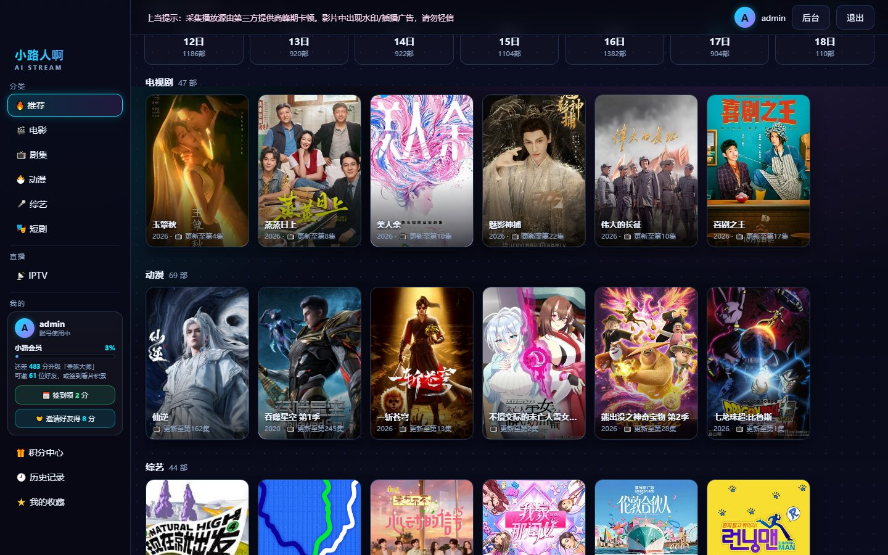
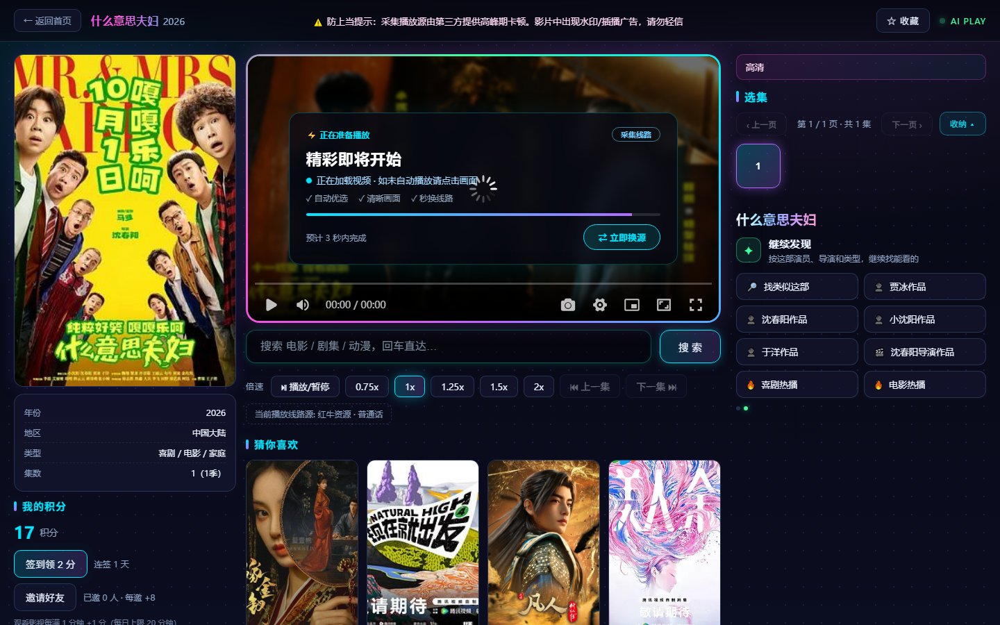
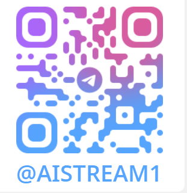

# AIStream


> **一套自托管的影视聚合站：TMDB 榜单 + 你自己的采集站 + IPTV 直播 + 电脑网页版（推荐使用） 全原生 Android 三端 APP。**
> Node 原生 `http` 写成，**零 npm 依赖**，Docker 镜像仅 **169MB**；RSA 一机一码授权，**激活后离线校验**。
> 不内置任何站点地址、密钥或会员体系——开箱是框架，填上你的源就能用。

| 首页 · 海报墙 | 播放页 · 换源 / 选集 / 追剧 |
|:---:|:---:|
|  |  |

---

## 30 秒了解

| | |
|---|---|
| **这是什么** | 影视资源聚合站（服务端 + Web 前台后台）+ 电脑网页版/手机/电视**全原生** Android APP |
| **适合谁** | 想在飞牛 / 群晖 / 宝塔 / 任意 Docker 机器上自建影视站的人 |
| **数据从哪来** | 你自己的苹果CMS 采集站 / IPTV 源 / TMDB Token（**一律不内置**，自己填） |
| **怎么跑** | 一段 `docker compose up -d`，或 PM2 / 裸机 `node server.js` |
| **怎么激活** | 激活页复制机器码 → **TG 私聊机器人秒回永久授权码**（免费） |
| **授权机制** | RSA-2048 一机一码，激活后**完全离线校验**，不连作者服务器 |

---

## ✨ 亮点

- 📱 **真·原生三端 APP**： 电脑网页版（推荐使用） 手机 / 平板 + 电视盒子两套全原生 Kotlin 客户端（**不是网页套壳**），ExoPlayer 硬解，遥控器 / 触摸都顺手；同一把签名，直接覆盖安装。
- 🤖 **TG 机器人秒发授权码**：入群 [[@AIStreamAuth_Bot](https://t.me/AIStreamAuth_Bot](https://t.me/AIStream1)) 发机器码，**获取永久码**；签发跑在 Cloudflare，飞牛关机也不影响新用户激活。
- 🧩 **零依赖站点内核**：Node 原生 `http`，不装任何 npm 包，镜像 169MB；播放器 Artplayer + hls.js **自托管，页面不连任何外部 CDN**。
- 🔀 **智能换源**：解析线路优先 + 跨站切换的换源面板；官方 + 采集线路合并去重，官方线路排前带 ★。
- 🚫 **m3u8 广告过滤**：服务端滤掉插播广告，APP 播放时实时显示「已拦截 N 条」。
- ⏩ **自动跳过片头片尾**：跟随账号权限，电影不自动跳，剧集按规则精准跳过。
- 📺 **IPTV 直播带节目单**：EPG 节目单、三档兜底（直连 → 代理 → 切下一台）、25s 看门狗保活。
- 📅 **追剧 & 续播**：追剧日历 + 继续观看（进度**绑集号**，换集不丢进度）+ 断点续播。
- 🖼️ **海报磨砂背景 & 防盗链**：详情页海报磨砂大图；海报走站点图片代理绕防盗链，第三方图床不再 418。
- 📡 **投屏 & 画中画**：DLNA 投屏（host 网络）、画中画小窗播放。
- 🎟️ **积分社区体系**：每日签到、会员兑换、邀请注册。
- 🛡️ **永久授权 + 空壳分发**：RSA-2048 一机一码，未激活 = 全部业务接口 402，没有旁路开关；功能全给，凭据一律不内置。

## 架构一览

```
                  ┌─────────────────────────────┐
    电脑网页   ──▶│ IPH或者域名即可访问           │
   手机 / 平板 ──▶│  AIStream-Native.apk        │
   电视 / 盒子 ──▶│  AIStream-TV.apk            │  Kotlin + ExoPlayer（全原生）
                  └──────────────┬──────────────┘
                                │ 填你的站点地址 + 账号
                 ┌──────────────▼──────────────┐
   任意浏览器 ───▶│  aistream  server.js        │  Node 原生 http · 零 npm 依赖
                 │  ├─ 前台/后台（public/）     │  ArtPlayer + hls.js 自托管
                 │  ├─ 采集站（苹果CMS v10）    │
                 │  ├─ 解析线路 / 上游资源库    │
                 │  ├─ IPTV 直播 + EPG         │
                 │  └─ m3u8 索引级去广告       │
                 └──────────────┬──────────────┘
                                │ 数据卷 data/
                 ┌──────────────▼──────────────┐
                 │  config.json / users / 历史 │  授权码：RSA-2048 本机验签（离线）
                 └─────────────────────────────┘
```

## 📱 Android 原生客户端 —— 免登录直接下载

| 版本 | 下载 | 一句话 |
|---|---|---|
| **手机 / 平板** | [**⬇ AIStream-Native.apk**](https://github.com/xiaolurenya/AIStream/releases/latest/download/AIStream-Native.apk) | Kotlin + ExoPlayer 全原生，原生硬解，**不是网页套壳** |
| **电视 / 盒子（TV 版）** | [**⬇ AIStream-TV.apk**](https://github.com/xiaolurenya/AIStream/releases/latest/download/AIStream-TV.apk) | 遥控器专属界面，也支持触摸 / 手机安装 |

两个包同一把签名密钥，**直接覆盖安装即可，不用先卸载**。
APP 不内置任何服务器地址——打开填你自己站点的地址 + 端口 + 账号密码就能进，凭证只存手机本机。
· [全部版本 / 更新日志](https://github.com/xiaolurenya/AIStream/releases)

### 🐛 提交 Bug · 提需求 · 交流

**👉 [提交 Bug](https://github.com/xiaolurenya/AIStream/issues/new?template=bug-report.yml)
· [功能建议](https://github.com/xiaolurenya/AIStream/issues/new?template=feature-request.yml)
· TG 群 [t.me/AIStream1](https://t.me/AIStream1)**

提 Issue 请带**版本 + 复现步骤 + 环境 + 截图**，站点端和 APP 端的问题都收，也欢迎直接 PR。

---

## 功能清单

- **前台**：栏目混排（TMDB 榜单 / 你的采集站 / 内置热门数据，配了采集站自动成栏目）、分类分页、聚合搜索、详情+选集+猜你喜欢、追剧日历、继续观看（进度绑集号）、公告广播、独立移动端适配。
- **播放**：Artplayer + hls.js 自托管，**页面不连任何外部 CDN**；换源面板（解析线路优先 + 跨站切换）；**m3u8 插播广告服务端过滤**（APP 播放时显示已拦截数）；起播看门狗慢起播不误换线；自动跳片头片尾（跟随账号权限）；断点续播、倍速、投屏（DLNA）。
- **APP**：详情页官方+采集线路合并去重、官方线路排前打★；自动跳过片头片尾；画中画；直播 IPTV 带节目单；海报走站点图片代理绕防盗链；积分签到、会员兑换、邀请注册。
- **后台**：首页栏目、采集站（地址自动规范化 + 连通自检 + 批量导入）、解析线路、上游接入、用户/会员/权限矩阵、积分签到、公告广播、IPTV、广告过滤、授权管理、日志。

> **授权体系**：RSA-2048 非对称签发，一机一码、**永久授权**、激活后离线校验。公钥随代码分发（只能验签），私钥只在你自己的 `data/config.json`，clone 下来的代码没有签发能力——这是设计，不是 bug。
> **空壳原则**：功能全给，凭据一律不内置（采集站地址 / 上游密钥 / IPTV 源 / TMDB Token 都要你自己填）。凭据共刷会导致上游限流封号，**一实例一号，禁止共用**。

## 三分钟装好（Docker Compose）

```yaml
services:
  aistream:
    image: xiaoluya/aistream:latest
    container_name: aistream
    user: "0:0"
    restart: always
    ports:
      - "8890:8890"
    environment:
      - TZ=Asia/Shanghai
      - PORT=8890
      - DATA_DIR=/data
    volumes:
      - /vol1/1000/aistream/data:/data   # 左边改成你自己的路径
```

```bash
docker compose up -d
docker compose logs -f        # 看到 [aistream] listening on 0.0.0.0:8890 就成了
```

打开 `http://你的IP:8890` → 进激活页。默认 bridge 网络不占宿主机网络栈；**要用 DLNA 投屏**就把 `ports:` 换成 `network_mode: host`。

- **飞牛 fnOS**：Docker → 项目(Compose) → 粘贴上面这段 → 卷路径改自己的 → 启动。路径要选没有其他 compose 项目的空目录。
- **群晖**：Container Manager → 项目 → 新建 → 粘贴 Compose → 部署。
- **宝塔**：Node 版本管理器(20/22) + PM2，上传 `server.js` 和 `public/` 到 `/www/wwwroot/aistream/`，`DATA_DIR=./data PORT=8890 pm2 start server.js --name aistream && pm2 save`，再反代到 8890。
- **裸机调试**：`DATA_DIR=./data PORT=8890 node server.js`。
- **镜像拉不动**：`git clone` 本仓库后 `docker build -t xiaoluya/aistream:latest .`，本地构建约十几秒。

## 激活（免费 · 永久 · 机器人秒发）

1. 打开站点 → 激活页有一串**机器码**（如 `FB4C-EAB2-EC4E-499A`），复制。
2. **TG 私聊 [@AIStreamAuth_Bot](https://t.me/AIStreamAuth_Bot)**（[群 t.me/AIStream1](https://t.me/AIStream1) 里就有）→ 把机器码发给机器人 → **几秒内回永久授权码**。
   - 也可以把机器码发在群里，机器人会**私聊**把码发给你（码不在群里公开）。
3. 粘进激活页 → 自动进站。全程本地校验，**支持离线激活**。

> 机器码会变吗？存在 `data/config.json`，数据卷在就不变（重建容器也不变）；换数据卷 / 清空 `data/` 会重新生成，重新签发同样免费永久。

默认后台账号 **`admin` / `admin123`**，**装完立刻改密码**。

## 装完第一步：接入采集站

后台 → 采集站 → 添加，填苹果CMS v10 采集接口（`https://example.com` 或完整 `/api.php/provide/vod`，地址会自动规范化）→ 点「立即自检」→ 保存后前台刷新，该站自动成为首页栏目。
**一个采集站都不配也能用**：首页有内置热门数据（无需密钥），只是没有播放源。批量导入用后台「批量导入」（逐条真测后才入库）。

## 环境变量

| 变量 | 默认 | 说明 |
|---|---|---|
| `PORT` | `8890` | 监听端口 |
| `DATA_DIR` | `/data` | 配置 / 用户 / 收藏 / 历史 / 图片缓存都在里面 |
| `TMDB_TOKEN` | 空 | 可选，不填则 TMDB 榜单不可用，采集站与内置数据源不受影响 |
| `OUT_PROXY` | 空 | 出网代理 `host:port`，直连 TMDB / 图床不通时才需要 |
| `PEPPER` | 内置 | 密码哈希盐，改了已有用户密码会失效 |

**数据全在 `data/`**：`docker compose pull && docker compose up -d` 重建不丢数据，删 `data/` 才会。**升级前先 `cp -r data data.bak`。**

## 常见问题

- **打开是激活页**：TG 私聊 [@AIStreamAuth_Bot](https://t.me/AIStreamAuth_Bot) 发机器码，秒回永久码。没有跳过激活的开关。
- **首页空白**：没加采集站。后台 → 采集站 → 添加 → 立即自检。没配也有内置热门数据，不会白屏。
- **APP 连不上站点**：① 手机浏览器先打开站点地址，浏览器都打不开就不是 APP 的问题；② 地址只填 IP/域名不带路径；③ 账号密码就是网页登录那套。
- **APP 播不出来**：先用浏览器试同一部片——浏览器也不行就是片源问题。浏览器能播则多半是后台「解析线路」为空（站方给播放页地址时需要），配一条再试。
- **APP 签名不一致装不上**：官方 Release 全部同一把密钥，直接覆盖安装。出现这个提示说明装的不是官方版，卸载后装官方 Release 即可。
- **想用自己的域名 + HTTPS**：反代到 8890 即可（Nginx / Caddy / 宝塔反代 / frp 都行），站点本身不需要证书。

## 免责声明与使用限制

> 使用、复制、修改或分发本项目（含源码、镜像及任何派生内容）即视为你已**全部接受**以下条款。

1. **禁止用于任何商业或盈利行为**：严禁收费观看、会员售卖、广告分成、引流变现、付费部署、代搭建收费、二次分发转售，或作为任何商业产品/服务的组成部分。
2. **仅供技术研究与交流**：本项目是影视聚合**框架**，不生产、不存储、不上传、不缓存任何影视内容，所有内容源由使用者自行接入。
3. **如不同意条款，或所在地区有合规要求，请在 24 小时内删除全部副本。**
4. **请勿在公开场合宣传推广**：请勿在短视频平台、论坛、社群、公开教程等渠道传播引流，后果由传播者自行承担。
5. **内容与合规责任完全在使用者**：接入源的合法性由使用者自行判断承担，一切法律后果与本项目及作者无关。授权码只是软件使用授权，不构成对所展示内容的任何授权。
6. **按「现状」提供，无任何担保。**

**官方 TG 群（免费获取永久授权码 / 交流反馈）：[https://t.me/AIStream1](https://t.me/AIStream1)**
**授权机器人（进上方TG群私聊发机器人）即可获取授权码



<sub>第三方组件：[hls.js](https://github.com/video-dev/hls.js)（Apache-2.0，`public/vendor/hls.min.js`）· [ArtPlayer](https://github.com/zhw2590582/ArtPlayer)（MIT，`public/vendor/artplayer.js`）</sub>
