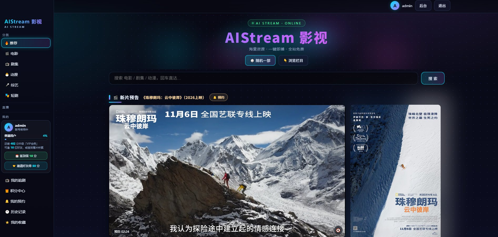
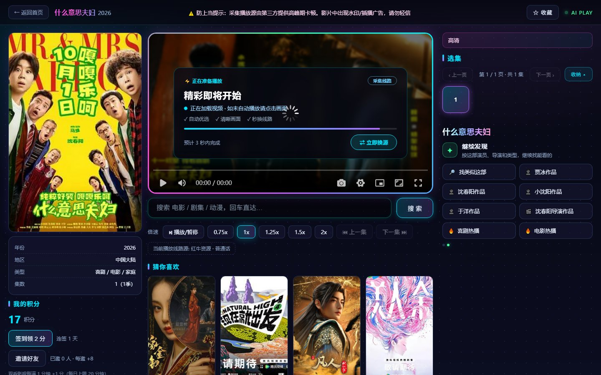
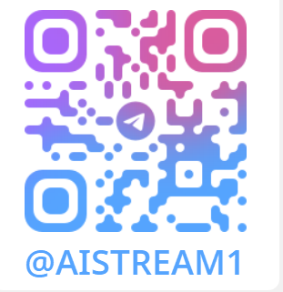

# AIStream

自托管的影视聚合站。自己填采集站、IPTV 源或 TMDB Token，就能在浏览器和手机、电视上看。服务端用 Node 原生 http 写成，没有 npm 依赖，Docker 镜像约 169MB。站点需要授权码激活，激活后离线校验。


| 首页 | 播放页 |
|:---:|:---:|
|  |  |

## 关于这个项目

项目由三部分组成：服务端和网页前后台、手机客户端、电视客户端。它本身不提供任何影视内容，也不内置采集站地址、上游密钥或会员账号，装完只是一个框架，数据源要自己配置。

网页端包含前台浏览播放和后台管理；手机端和电视端是两个独立的 Android 原生客户端（Kotlin + ExoPlayer），不是网页套壳，需要在 APP 里填写自己站点的地址和账号。

授权码是免费的：打开激活页复制机器码，发到 TG 群 [AIStream1](https://t.me/AIStream1) 换取。签发用 RSA-2048，一机一码，激活之后不再连作者服务器。

## 功能

- 首页栏目可混排 TMDB 榜单、采集站分类和内置热门数据；分类分页、聚合搜索、详情页选集、追剧日历、继续观看。
- 播放用 ArtPlayer + hls.js，库文件随镜像分发，页面不依赖外部 CDN。换源面板会先试解析线路，再看采集线路；m3u8 插播广告在服务端过滤；支持自动跳过片头片尾、断点续播、倍速、DLNA 投屏。
- IPTV 直播带 EPG 节目单，直连失败会依次尝试服务端代理和下一个源。
- 后台可以管理首页栏目、采集站（地址规范化、连通自检、批量导入）、解析线路、用户和权限、积分签到、公告、IPTV、广告过滤、授权和日志。
- 手机端和电视端支持线路合并去重、自动跳过片头片尾、画中画、图片代理，以及签到、兑换、邀请注册。

海报、剧照走站点自己的图片代理，用来绕开第三方图床的防盗链。配置和观看记录都存在数据卷里，重建容器不会丢。

## 安装

### Docker Compose

适用于飞牛、群晖、宝塔，以及任何能跑 Docker 的 x86 / ARM 机器。

```yaml
services:
  aistream:
    image: xiaoluya/aistream:latest
    pull_policy: always
    container_name: aistream
    user: "0:0"
    restart: always
    ports:
      - "8890:8890"
    environment:
      - TZ=Asia/Shanghai
      - PORT=8890
      - DATA_DIR=/data
    volumes:
      - /vol1/1000/aistream/data:/data   # 左边改成你自己的路径
```

```bash
docker compose up -d
docker compose logs -f        # 看到 [aistream] listening on 0.0.0.0:8890 就成了
```

打开 `http://你的IP:8890` 进激活页。`pull_policy: always` 表示每次启动都会先拉最新镜像，所以以后出新版本，在面板点「重启 / 重新部署」就会自动更新，数据卷里的配置和记录不会丢。默认 bridge 网络；要用 DLNA 投屏就把 `ports:` 换成 `network_mode: host`。

镜像拉不动时换网络，或者先手动 `docker pull xiaoluya/aistream:latest` 再重启容器。本仓库只分发预构建镜像，不提供从源码构建的入口。仓库根目录另有 `docker-compose.yml`、`update.sh`、`UPGRADE.md`，内容和上面一致。

后台「概览」会显示当前版本并检查更新。发现新版本时可以直接点「一键更新」，它会在数据目录写一个请求文件，由宿主机的定时任务执行 `docker compose pull && up -d`。这个任务默认没装，在 compose 目录执行一次 `bash update.sh cron` 即可；不装的话按钮点了不会生效，仍可以用上面的「重启 / 重新部署」更新。也可以叠加 `docker-compose.auto-update.yml` 用 Watchtower 每小时自动检查。

### 飞牛 fnOS 安装包

下载 [aistream-1.5.46.fpk](https://github.com/xiaolurenya/AIStream/releases/download/v1.5.46/aistream-1.5.46.fpk)，在「应用中心 → 设置 → 手动安装」里上传。安装向导里可以改访问端口，默认 8890；如果 8890 已经被别的程序占用，填一个没被占用的端口即可，桌面图标会跟着这个端口打开。

群晖用 Container Manager 新建项目，粘贴上面的 Compose 部署即可。

## 激活

1. 打开站点，激活页会显示机器码（如 `FB4C-EAB2-EC4E-499A`），复制它。
2. 发到 TG 群 [AIStream1](https://t.me/AIStream1)，按群内指引领取永久授权码。
3. 粘进激活页即可进站。

机器码存在 `data/config.json`，数据卷在就不变，重建容器也不会变；清空 `data/` 会重新生成，重新领取同样免费。

默认后台账号 `admin` / `admin123`，装完请立刻改密码。

## 接入采集站

后台 → 采集站 → 添加，填苹果CMS v10 采集接口（`https://example.com` 或完整 `/api.php/provide/vod`，地址会自动规范化），点「立即自检」再保存，前台刷新后该站会成为首页栏目。

一个采集站都不配也能打开，首页有内置热门数据，只是没有播放源。批量导入请走后台的「批量导入」，它会逐条实测后才入库。

## 手机和电视客户端

APP 不内置服务器地址，打开后填自己站点的地址、端口和账号密码就能连，凭证只存在手机本机。两个包用同一把签名，覆盖安装即可，不用先卸载。

| 客户端 | 下载 | 说明 |
|---|---|---|
| 手机 / 平板 | [AIStream-Native.apk](https://github.com/xiaolurenya/AIStream/releases/download/v1.5.39/AIStream-Native.apk) | Kotlin + ExoPlayer，触摸操作 |
| 电视 / 盒子 | [AIStream-TV.apk](https://github.com/xiaolurenya/AIStream/releases/download/v1.5.39/AIStream-TV.apk) | 遥控器操作的界面，也支持触摸 |

APP 当前版本是 v1.5.39，之后的版本只更新了网页端和飞牛安装包，APP 没有改动。历史版本和更新日志见 [Releases](https://github.com/xiaolurenya/AIStream/releases)。

## 环境变量

| 变量 | 默认 | 说明 |
|---|---|---|
| `PORT` | `8890` | 监听端口 |
| `DATA_DIR` | `/data` | 配置、用户、收藏、历史、图片缓存都在这里 |
| `TMDB_TOKEN` | 空 | 可选，不填则 TMDB 榜单不可用，采集站与内置数据源不受影响 |
| `OUT_PROXY` | 空 | 出网代理 `host:port`，直连 TMDB 或图床不通时才需要 |
| `PEPPER` | 内置 | 密码哈希盐，改了之后已有用户密码会失效 |

升级前建议先备份：`cp -r data data.bak`。数据都在 `data/`，重启、重新部署或 `docker compose pull && docker compose up -d` 都不会丢。

## 常见问题

- **打开是激活页**：把机器码发到 TG 群领取授权码，没有跳过激活的开关。
- **首页空白**：没加采集站，去后台添加并自检。没配也有内置热门数据，正常不会白屏。
- **APP 连不上站点**：先用手机浏览器打开站点地址；浏览器都打不开就不是 APP 的问题。地址只填 IP 或域名，不带路径，账号密码和网页端一致。
- **APP 播不出来**：先用浏览器试同一部片，浏览器也不行多半是片源问题。浏览器能播则检查后台「解析线路」是否为空，配一条再试。
- **APP 提示签名不一致**：官方 Release 都是同一把密钥，出现这个提示说明装的不是官方版，卸载后装官方包即可。
- **想用域名和 HTTPS**：反代到 8890 就行，站点本身不用配证书。
- **飞牛安装包上传后提示解析错误**：确认下载文件是 10981 字节左右的 `.fpk`，没有被浏览器改名成 `.zip`；GitHub 直连不稳定时换个网络重下。1.5.46 已针对安装解析做过修复。

## 反馈

[提交 Bug](https://github.com/xiaolurenya/AIStream/issues/new?template=bug-report.yml) · [功能建议](https://github.com/xiaolurenya/AIStream/issues/new?template=feature-request.yml) · TG 群 [AIStream1](https://t.me/AIStream1)

提 Issue 请带上版本、复现步骤、环境和截图。

## 免责声明与使用限制

使用、复制、修改或分发本项目（含源码、镜像及派生内容）即视为接受以下条款。

1. 禁止用于任何商业或盈利行为，包括收费观看、会员售卖、广告分成、引流变现、付费部署、代搭建收费、二次分发转售，或作为商业产品的一部分。
2. 仅供技术研究与交流。本项目是影视聚合框架，不生产、不存储、不上传、不缓存任何影视内容，内容源由使用者自行接入。
3. 如不同意条款，或所在地区有合规要求，请在 24 小时内删除全部副本。
4. 请勿在短视频平台、论坛、社群、公开教程等渠道宣传推广，后果由传播者自行承担。
5. 接入源的合法性由使用者自行判断承担，一切法律后果与本项目及作者无关。授权码只是软件使用授权，不构成对所展示内容的授权。
6. 按现状提供，不提供任何担保。

官方 TG 群（领取授权码、交流反馈）：[AIStream1](https://t.me/AIStream1)



<sub>第三方组件：[hls.js](https://github.com/video-dev/hls.js)（Apache-2.0，`public/vendor/hls.min.js`）· [ArtPlayer](https://github.com/zhw2590582/ArtPlayer)（MIT，`public/vendor/artplayer.js`）</sub>
